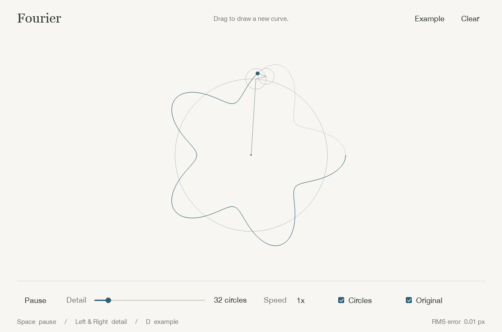

# Fourier epicycles

Draw a curve and watch rotating circles reconstruct it. Adjust the number of
circles to see how much detail each Fourier coefficient contributes.



## Run

Python 3.10+ required. Uses NumPy and pygame-ce (imported as `pygame`).

```sh
python -m venv .venv
source .venv/bin/activate       # Windows: .venv\Scripts\activate
python -m pip install -r requirements.txt
python main.py
```

A demo loads on startup. Hold the left mouse button in the canvas to draw your
own curve, then release to animate it. Open strokes are closed automatically.

| Control | Action |
| --- | --- |
| Slider or Left / Right | Change the number of circles |
| Pause button or Space | Pause / resume |
| Speed button or Up / Down | Change playback speed |
| Circles checkbox or C | Show / hide circles |
| Original checkbox or O | Show / hide the original curve |
| Example button or D | Cycle through three demos |
| Clear button or R | Clear the canvas |
| Esc | Quit |

## How it works

The drawn path is resampled at 256 equal arc-length intervals, so slower mouse
movement does not receive extra weight. A complex FFT produces coefficients
with signed frequencies; the largest amplitudes are drawn first. Playback uses
elapsed time and is capped at 60 FPS.

The endpoint is `origin + sum(c[k] * exp(2πi * frequency[k] * phase))`, where phase
runs from 0 to 1. RMS error measures distance from the resampled path, in pixels;
it does not measure detail lost when the original stroke was sampled.

`fourier.py` contains the sampling and reconstruction math; `main.py` handles
input, animation, and rendering.

## Test and preview

```sh
python -m unittest discover -s tests -v
python main.py --screenshot docs/preview.png
```

The preview command renders a demo to PNG without opening a window. Tests cover
reconstruction accuracy, signed frequencies, sampling, controls, and the headless
rendering path.
